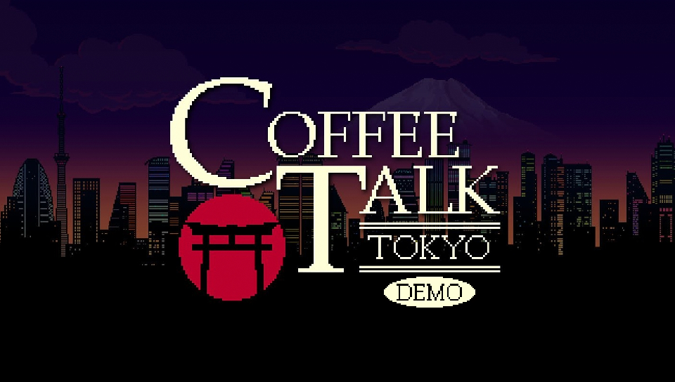
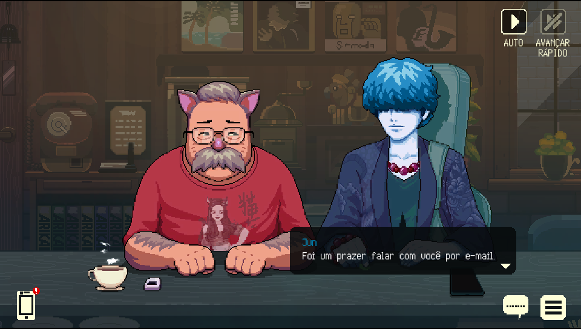
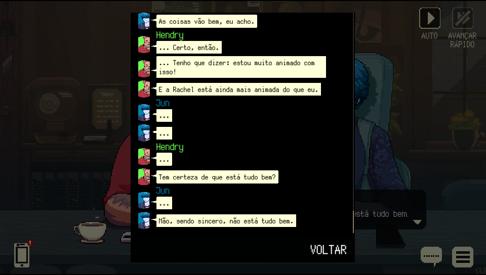
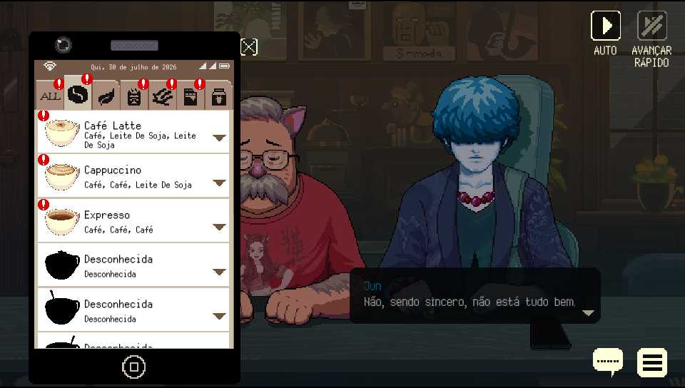
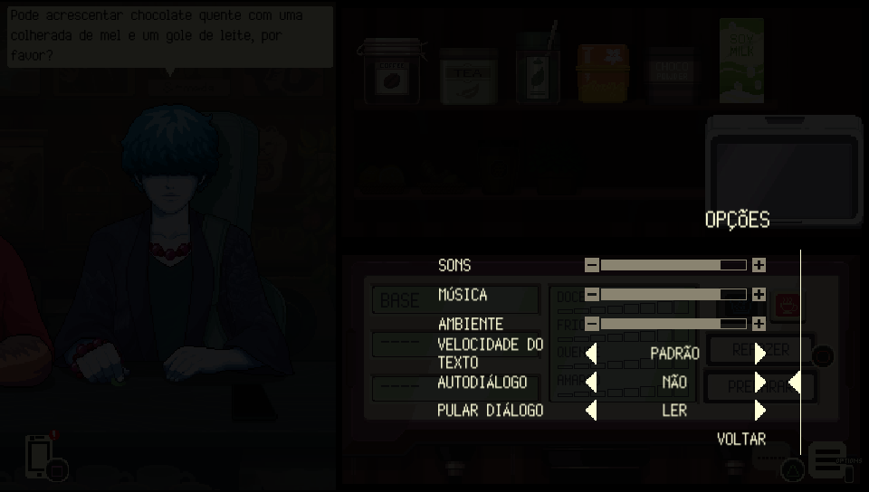

<div align="center">


# Coffee Talk Tokyo Vita

*An unofficial native Unity backport for PlayStation Vita.*

[](https://github.com/WolffsRoom/CoffeeTalkTokyoVita)
[](https://github.com/WolffsRoom/CoffeeTalkTokyoVita)
[](https://unity.com/)

[**Wolff's Room**](https://wolffsroom.github.io/WolffsRoomSite/) · [**Releases**](https://github.com/WolffsRoom/CoffeeTalkTokyoVita/releases) · [**Report an issue**](https://github.com/WolffsRoom/CoffeeTalkTokyoVita/issues)

</div>

---

<div align="center">
  <a href="assets/demo-cover.png"></a>
</div>

## About

**Coffee Talk Tokyo Vita** is a work-in-progress backport of **Coffee Talk Tokyo** for PlayStation Vita. I'm adapting the original Unity project from the modern **Unity 6 / 2024 generation** to **Unity 2017.4.10f1**, which supports native Vita (PSP2) builds.

This is my **first Unity port**. Rather than emulating the PC game, the goal is to adapt its scenes, gameplay systems, controls, assets, and presentation to run natively on the handheld.

My longer-term ambition is to bring the **Coffee Talk series** to PS Vita. Starting with this newer entry is an experiment in what the hardware and the legacy Unity runtime can support.

## Development status

| Edition | Current status |
|---|---|
| **Free Demo** | Already reached gameplay on real PS Vita; fixes, controls, visual review and optimization still in progress before public release |
| **Full Game** | Separate, longer-term backport; requires substantially more compatibility work and testing before a public release |

**The free demo is not a confirmed public release yet.** A downloadable build will appear on [Releases](https://github.com/WolffsRoom/CoffeeTalkTokyoVita/releases) when it's ready, with an announcement on Wolff's Store. The Full edition is **not ready for download**.

### Current focus

- Unity 2017 compatibility for scenes, scripts, sprites, UI, shaders, audio and video.
- PlayStation Vita controls, touchscreen input, on-screen keyboard, and save behavior.
- Rendering fixes, performance tuning, and memory use.
- Regression testing on Vita hardware and in development builds.

## Screenshots

<table align="center">
<tr>
<td align="center"><a href="docs/screenshots/demo-01.png"></a></td>
<td align="center"><a href="docs/screenshots/demo-02.png"></a></td>
</tr>
<tr>
<td align="center"><a href="docs/screenshots/demo-03.png"></a></td>
<td align="center"><a href="docs/screenshots/demo-04.png"></a></td>
</tr>
</table>

<sub>Development captures at 960 × 544. Visuals and features are subject to change before release.</sub>

## Technical overview

```text
Coffee Talk Tokyo (modern Unity)
             |
   Compatibility backport
             |
      Unity 2017.4.10f1
             |
       PSP2 / IL2CPP
             |
      PlayStation Vita
```

This repository is a **lightweight public project page** for progress, screenshots and eventual release information. The full proprietary Unity project, commercial game data, and licensed development SDK files are **not distributed here**.

## Credits and legal

- **Toge Productions and the original Coffee Talk Tokyo development team** — original game and creative work.
- **Wolff's Room** — unofficial PS Vita backport and compatibility work.
- **Unity** — game engine.

Coffee Talk Tokyo and all original artwork, characters, music, dialogue and game content remain the property of their respective rights holders. This is an independent, unofficial fan project and is not endorsed by the original creators, Sony or Unity. Please support the official game.

<div align="center">

---

*Wolff's Room · Made for fans, by fans.*

</div>
